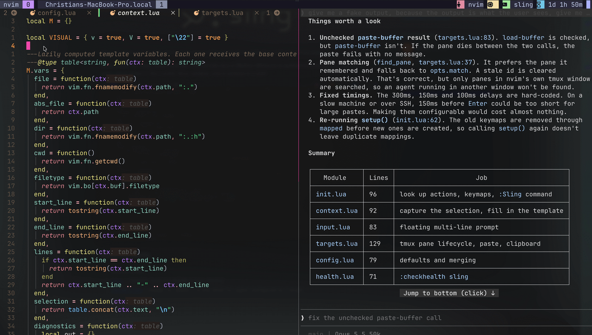
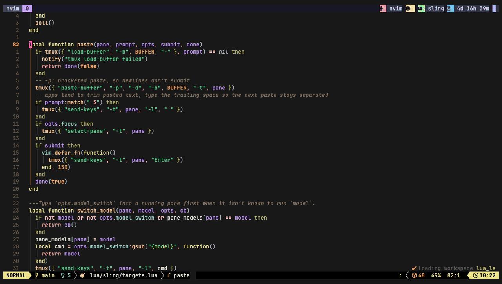
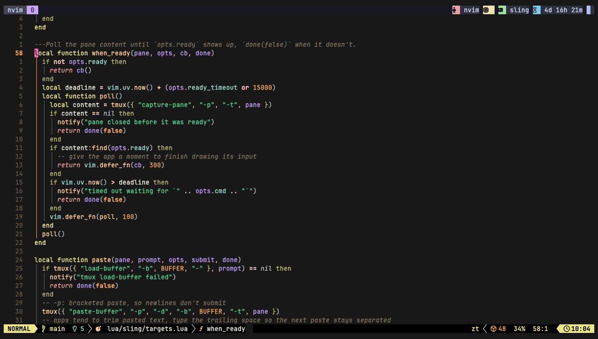

<h1 align="center">
  <picture>
    <source media="(prefers-color-scheme: dark)" srcset="assets/sling-dark.svg">
    
  </picture>
</h1>

> Human tell AI make code. AI make code. Code bad. Sling grab bad line, sling throw at AI. AI make code. Code bad. Sling grab…
>
> Still bad code. Less copy paste.

Select code, hit a key, type a prompt. The prompt plus a file/line reference lands in your CLI agent (Claude Code by default) running in a tmux pane. No agent pane in the current tmux window? sling opens one in a split.

Bigger task? Build up the context first: collect references from several files, folders (file trees work too) and notes in a scratch, then send it all as one prompt. The scratch is saved per project and survives restarts.

## Demo

The demos use custom `<leader>k*` mappings; the defaults are `<leader>a*`, see [Default actions](#default-actions).

### Existing agent session

Agent already running in the window: prompt + reference are pasted straight into it.



### New agent session

No agent pane yet: sling opens one in a split, then pastes the prompt.


### Model picker

The prompt window shows the model, `<C-t>` cycles it. A new pane starts on the picked model.



### Scratch

Collect references from several files and the file tree, add a note, send it all as one prompt.



## Requirements

- Neovim **0.10+**
- [tmux](https://github.com/tmux/tmux) — Neovim must run **inside** a tmux session
- [Claude Code](https://docs.claude.com/en/docs/claude-code) (`claude` on `$PATH`), or any other CLI agent configured as a target

Check:

```sh
nvim --version | head -1   # NVIM v0.10.0 or newer
tmux -V
which claude
```

## Getting started

### 1. Install

Works without configuration: keymaps and the `:Sling` command are registered on startup. `setup()` is only needed to change the defaults.

**[lazy.nvim](https://github.com/folke/lazy.nvim)**

```lua
{
  "Christian-Hoeller/sling",
  event = "VeryLazy",
  opts = {}, -- optional, your config goes here
}
```

For a local checkout use `dir = "~/projects/sling"` instead of the repo name.

**vim.pack** (Neovim 0.12+, built-in plugin manager)

```lua
vim.pack.add({ "https://github.com/Christian-Hoeller/sling" })
-- optional
require("sling").setup({})
```

**Manual (native packages)**

```sh
git clone https://github.com/Christian-Hoeller/sling \
  ~/.local/share/nvim/site/pack/plugins/start/sling
nvim -c 'helptags ALL' -c q   # generate :help tags
```

```lua
-- init.lua, optional
require("sling").setup({})
```

Update with `git -C ~/.local/share/nvim/site/pack/plugins/start/sling pull`.

### 2. Start Neovim inside tmux

```sh
tmux new -s work
nvim .
```

### 3. Check

```vim
:checkhealth sling
```

Reports the Neovim version, tmux, whether Neovim runs inside tmux, the target commands (`claude`) and the configured actions.

### 4. Sling

1. Put the cursor on a line, or select lines in visual mode.
2. Press `<leader>ap`, type a prompt, e.g. `why is this slow?`, hit `<C-s>` (`<Enter>` adds a new line; in normal mode it sends too).
3. A pane running `claude` opens to the right (or an existing one is reused). Once Claude Code is ready, this is pasted into its input:

   ```
   why is this slow?

   @lua/sling/targets.lua#L54-73
   ```

4. Review and press `<Enter>` in the Claude pane — or use `<leader>aP` to submit right away.

`claude` already running in another pane of the same tmux window? It's detected and used instead of opening a new split.

Not in tmux? Use the built-in clipboard target:

```vim
:lua require("sling").run("ask", { target = "clipboard" })
```

### Troubleshooting

| Message                       | Cause / fix                                                               |
| ----------------------------- | ------------------------------------------------------------------------- |
| `not inside tmux`             | start nvim from a tmux session (`$TMUX` must be set)                      |
| `could not open tmux pane`    | check `split` args; `tmux split-window -h claude` must work by hand       |
| `timed out waiting for <cmd>` | `ready` pattern not seen in the pane within `ready_timeout` (default 15s) |
| `timed out waiting for claude` in a new folder | Claude Code asks "Do you trust this folder?" first; answer it in the pane, then sling again |
| keymaps missing / different   | another plugin uses `<leader>a*` (e.g. LazyVim's AI group); remap the actions, see [Configuration](#configuration) |
| keymaps on `\` instead of space | `mapleader` is set after sling loaded; set it before plugins load |
| `/model …` ends up in the prompt and gets submitted | the agent's input wasn't empty when the model changed (e.g. after `add`); send or clear the input before picking another model |

Run `:checkhealth sling` first.

## Usage

### Default actions

| Key          | Action       | What it does                                 |
| ------------ | ------------ | -------------------------------------------- |
| `<leader>ap` | `ask`        | ask for a prompt, prefill it (no submit)     |
| `<leader>aP` | `ask_submit` | ask for a prompt, submit it                  |
| `<leader>aa` | `add`        | paste only the `@file#L1-5` reference        |
| `<leader>ac` | `collect`    | add the reference to the scratch, open it    |
| `<leader>as` | `scratch`    | open the scratch                             |
| `<leader>ad` | `fix`        | send the diagnostics of the range with "fix" |

All work in normal mode (cursor line) and visual mode (selection). In a file tree (neo-tree, snacks explorer, nvim-tree, oil) the entry under the cursor is used: `@lua/sling/` for a folder, `@lua/sling/init.lua` for a file. Select several with `V`, each becomes its own line.

The **scratch** collects references and notes for one prompt. It is saved per working directory, so it survives restarts. `<Esc>` closes and keeps it, `<C-l>` empties it (`u` undoes), `<C-s>` sends it like `ask` and clears it once it arrived; a failed send keeps it.

The **model** shows in the title of the prompt and scratch window; `<C-t>` cycles through the target's `models` (default: Opus 5.5, Fable 5.2, Sonnet 5.5, see [Configuration](#configuration)). The pick sticks for the session and applies to all actions sending to that target; targets without `models` (e.g. clipboard) have no picker. A new pane starts with `claude --model <id>`; a running pane on another model gets `/model <id>` typed first, so its input should be empty then.

### Command

```vim
:Sling              " runs `ask` on the cursor line
:Sling add          " any action, tab-completes
:'<,'>Sling fix     " with a range
```

### Help

`:help sling` has the full reference.

## Configuration

Three pieces: **templates** build the prompt, **targets** receive it, **actions** combine both with a keymap. Everything is merged into the defaults, so only set what you change.

```lua
opts = {
  template = "{input}\n\n{ref}",        -- default for all actions
  target = "claude",                        -- default target
  submit = false,                           -- default: prefill only

  -- prompt window: multi-line, wraps at `width`, grows up to `max_height`
  -- <C-s> submits (any mode), <CR> submits in normal mode, <Esc>/q cancels
  input = { width = 80, min_height = 3, max_height = 15 },
  scratch = { width = 100, min_height = 15, max_height = 30 }, -- scratch window, same fields
  model_key = "<C-t>",                      -- cycle the target's `models` in prompt/scratch window

  targets = {
    claude = {
      type = "tmux",
      cmd = "claude",
      split = { "-h" },          -- args for `tmux split-window`, e.g. { "-h", "-l", "40%" }
      reuse = true,              -- paste into a running pane instead of splitting again
      match = function(pane)     -- recognise panes started by hand: { id, command, title }
        return pane.command == "claude" or pane.title:find("Claude Code", 1, true) ~= nil
      end,
      ready = "Claude Code v",   -- lua pattern in the pane content: fresh pane is ready
      ready_timeout = 15000,     -- ms
      focus = true,              -- jump to the pane after sending
      models = {                 -- picked with `model_key`, first is the default; `{ name, id }` or id strings
        { name = "Opus 5.5", id = "claude-opus-5-5" },
        { name = "Fable 5.2", id = "claude-fable-5-2" },
        { name = "Sonnet 5.5", id = "claude-sonnet-5-5" },
      },
      model_flag = "--model",    -- new pane: `claude --model <id>`
      model_switch = "/model {model}", -- typed into a running pane on another model
    },
    clipboard = { type = "clipboard" },
    -- a target can also be a function, returning false marks a failed send
    log = function(prompt, ctx, action) print(prompt) end,
  },

  actions = {
    ask = { keys = "<leader>kp" },   -- change a default
    fix = false,                     -- disable a default
    tests = {                        -- add your own
      template = "Write tests for @{file}#L{lines}",
      submit = true,
      keys = "<leader>kt",
      desc = "Write tests",
    },
    explain = { template = "Explain:\n```{filetype}\n{selection}\n```", keys = "<leader>ke" },
  },

  -- extra template variables
  vars = {
    branch = function() return vim.trim(vim.fn.system("git branch --show-current")) end,
  },

  -- file trees: filetype -> fun(line): path of the entry on that line (neo-tree, snacks explorer, nvim-tree, oil built in)
  trees = {
    minifiles = function(line) return (MiniFiles.get_fs_entry(0, line) or {}).path end,
  },
}
```

### Action fields

| Field      | Type                 | Default              | Description                                                               |
| ---------- | -------------------- | -------------------- | ------------------------------------------------------------------------- |
| `template` | `string`             | top-level `template` | prompt template                                                           |
| `target`   | `string`             | top-level `target`   | name of a target in `targets`                                             |
| `input`    | `boolean \| string`  | `nil`                | ask for `{input}` first; a string is the input title; empty input cancels |
| `scratch`  | `boolean \| string`  | `nil`                | open the scratch instead; `template` is appended first; a string is the title |
| `submit`   | `boolean`            | top-level `submit`   | press Enter after pasting                                                 |
| `keys`     | `string \| string[]` | `nil`                | keymap(s)                                                                 |
| `mode`     | `string \| string[]` | `{ "n", "x" }`       | modes for `keys`                                                          |
| `desc`     | `string`             | `Sling: <name>`      | keymap description                                                        |
| `model`    | `string`             | picked model         | model id, skips the picker                                                |

### Template variables

| Variable        | Value                                  |
| --------------- | -------------------------------------- |
| `{input}`       | text typed at the prompt               |
| `{ref}`         | `@file#L1-5`, or `@path` in a file tree |
| `{file}`        | file path relative to cwd              |
| `{abs_file}`    | absolute file path                     |
| `{dir}`         | directory of the file, relative to cwd |
| `{cwd}`         | current working directory              |
| `{filetype}`    | buffer filetype                        |
| `{lines}`       | `10` or `10-20`                        |
| `{start_line}`  | first line of the range                |
| `{end_line}`    | last line of the range                 |
| `{selection}`   | selected text                          |
| `{diagnostics}` | diagnostics in the range, one per line |

Unknown placeholders are left as is.

### Lua API

```lua
require("sling").run("ask")
require("sling").run("ask", { submit = true })
require("sling").run("ask", { model = "claude-sonnet-5-5" }) -- fixed model, no picker
require("sling").run({ template = "Review @{file}", target = "clipboard" })
```

## License

MIT
